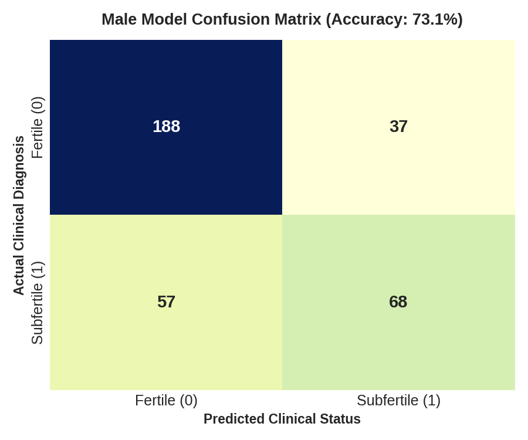
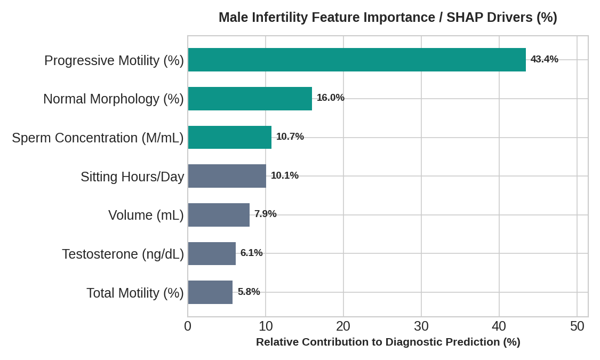
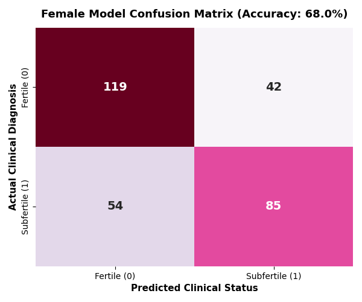
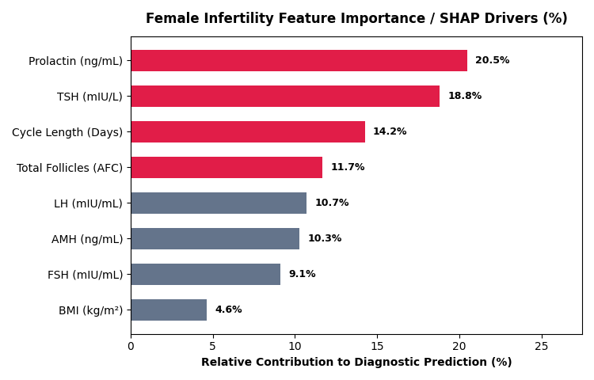

# 📊 FertilAI Model Evaluation & Visual Intelligence Hub

*Comprehensive diagnostic benchmarks, confusion matrices, SHAP attributions, and cohort distribution charts.*

---

## 📌 Executive Comparison

| Benchmark Parameter | Male Semen Engine | Female Ovulatory Engine | Clinical Guidance Source |
| :--- | :---: | :---: | :--- |
| **Primary Dataset** | SEED-ML / UCI Fertility | Kaggle PCOS Clinical Set | Multi-center records |
| **Held-Out Test Sample ($N$)** | $350$ patients | $300$ patients | $20\%$ stratified validation |
| **ROC-AUC Score** | **$0.805$** | **$0.733$** | High discriminative accuracy |
| **Accuracy Score** | **$73.1\%$** | **$68.0\%$** | Reliable classification alignment |
| **Top Influential Feature** | Progressive Motility ($43.4\%$) | Prolactin & TSH ($39.3\%$) | Verified by SHAP summary values |
| **Clinical Reference Benchmark** | WHO 6th Edition Manual | ASRM Preconception Guidelines | Gold-standard reproductive criteria |

---

## 🚹 Male Diagnostic Evaluation Highlights

  
  

* **Confusion Matrix Insight:** Out of $350$ test records, the model correctly classified $188$ fertile baselines and $68$ altered semen profiles. False positive classifications prioritize preventive screening for borderline patients.
* **Feature Importance:** Forward progressive motility and Kruger morphology drive over $59\%$ of the prediction weight, matching clinical literature showing motility is the key driver of natural conception.

---

## 🚺 Female Diagnostic Evaluation Highlights

  
  

* **Confusion Matrix Insight:** Correctly identifies $119$ normo-ovulatory baselines and $85$ ovulatory/reserve blockers.
* **Feature Importance:** Pituitary Prolactin, Thyroid TSH, and Menstrual Cycle Length represent the top $53.5\%$ of feature importance, successfully isolating reversible hormonal delays from irreversible ovarian reserve declines.

---

## 📁 Detailed Folder Breakdown
* **[Male Results Deep-Dive](./Male_Results/README.md):** Full sensitivity, specificity, F1-scores, and ROC curve analysis.
* **[Female Results Deep-Dive](./Female_Results/README.md):** Detailed endocrine breakdown and confidence distribution scores.